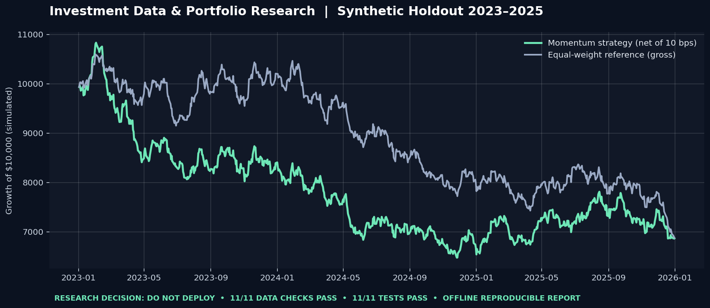

# Investment Data & Portfolio Research

**An end-to-end, reproducible quantitative research case study in Python and SQL-oriented data engineering**

> **Data disclosure:** This repo ships with **synthetic market data** generated from a fixed random seed. It is an engineering and research-methodology demonstration, **not** a tested real-market investment strategy. The packaged performance figures are simulation outputs, not historical security returns.



[**Open the full interactive HTML results dashboard**](outputs/dashboard.html) · [Methodology & limitations](docs/METHODOLOGY.md) · [Measured results](docs/RESULTS.md) · [Data dictionary](docs/DATA_DICTIONARY.md)

## The problem

An investment hypothesis can appear profitable for the wrong reasons: incorrect split handling, inconsistent market data, look-ahead leakage, unrealistic trading assumptions, or overfitting. Research teams need a repeatable way to test signals, trace the data behind every result, and decide whether a strategy is actually worth pursuing.

## What I built

- **Market-data ingestion:** deterministic synthetic OHLCV generator and a separately tested optional Alpha Vantage API parsing adapter (`src/api_adapter.py`); the API has **not** been used to generate the results
- **Corporate actions:** synthetic dividends/splits, split-aware return construction, and reconciliation-focused data rules
- **SQL research cache:** SQLite tables with composite keys, corporate-action joins, indexed asset/date lookups, and auditable SQL checks (`sql/schema.sql`, `sql/research_checks.sql`)
- **Data quality controls:** **11 fail-fast validation checks** covering schema, duplicate records, prices, actions, calendar, provenance, and more
- **Strategy research:** 63-day momentum, volatility weighting, trailing liquidity eligibility, top-three selection and monthly portfolio rebalancing
- **Bias controls:** indicators lagged two sessions for previous-close execution, 2021–2022 development period and untouched 2023–2025 holdout
- **Risk and model evaluation:** CAGR, volatility, Sharpe, maximum drawdown, turnover, cost stress tests and exploratory block-bootstrap intervals
- **Reporting:** a polished self-contained offline HTML dashboard, an interactive Streamlit dashboard with transaction-cost slider, exported daily results, audit weights, and machine-readable metrics
- **Testing:** **12 passing pytest checks**, including an explicit no-look-ahead mutation test and a stock-split test

## Measured findings · synthetic out-of-sample 2023–2025

| Metric | Momentum strategy (10 bps cost) | Equal-weight reference (before costs) |
|---|---:|---:|
| CAGR | **-11.39%** | -11.35% |
| Total return | -31.33% | -31.22% |
| Annualized volatility | 14.73% | 13.09% |
| Sharpe (0% risk-free) | -0.75 | -0.85 |
| Maximum drawdown | **-40.21%** | -35.10% |

**Research decision: reject / do not deploy.** The candidate fails to improve the benchmark's CAGR or drawdown, and its relative performance is uncertain. A paired 20-session block bootstrap gave a **95% exploratory CAGR-spread interval of -10.90 to +9.71 percentage points**. The strategy's CAGR falls from **-10.57% at zero trading costs** to **-14.63% at 50 bps**. The takeaway is not "I found alpha"; it is that rigorous validation stopped a weak hypothesis from looking stronger than it was.

The outputs are created by executing code, not manually entered into a mock dashboard. Re-run the project and the same numbers will be produced from the fixed-seed simulation.

## Run it locally

Requirements: Python 3.10+ and a terminal. From the repository root:

```bash
python -m venv .venv
source .venv/bin/activate               # Windows: .venv\Scripts\activate
pip install -r requirements.txt
python -m pytest -q
python -m src.run_pipeline
streamlit run dashboard.py
```

- Open `outputs/dashboard.html` directly in any browser for the **standalone, offline, interactive result chart** (no Python server needed after download)
- Run `streamlit run dashboard.py` to use the **interactive research controls** (evaluation-period selector and transaction-cost slider)
- Inspect `outputs/results.json` for exact metrics and checks, `outputs/portfolio_weights.csv` for allocation audit, and `outputs/daily_backtest.csv` for daily net returns

## Architecture

```text
SYNTHETIC generator ──> prices + actions ──> validation (11 checks)
optional API parser ──> [NOT used in provided experiment]
                                                  │
                                     split/dividend-aware returns
                                                  │
                           lagged 63d momentum + 21d volatility
                                                  │
                              trailing liquidity / monthly weights
                                                  │
                               self-financing backtest + fees
                                                  │
                 ┌────────────────────────────────┴─────────────────┐
          pytest / audit files                           metrics / dashboard
```

## File map

```text
src/
  generate_data.py      # synthetic data with split and dividend events
  api_adapter.py        # optional JSON market-data API adapter (not run)
  validation.py         # data-quality rules and total-return construction
  sql_store.py          # SQLite ingestion and auditable SQL checks
  backtest.py           # time-aware portfolio model, fees and risk metrics
  run_pipeline.py       # one-command rebuild of outputs and offline report
sql/                    # database schema and analyst-friendly quality queries
tests/test_research.py  # pytest suite, including no-look-ahead test
dashboard.py            # Streamlit dashboard with interactive controls
data/raw/               # generated labelled prices and corporate actions
data/processed/         # validated returns plus SQLite research cache
outputs/                # HTML report, JSON metrics, CSV audit and weights
docs/                   # methodology, limitations, research decision and schema
assets/                 # shareable static dashboard preview
```

## Why the approach matters

The project answers a real research engineering question: **can another analyst regenerate, audit and challenge this investment result without trusting a black-box notebook?** It gives them dated inputs, explicit adjustment conventions, pre-specified evaluation windows, risk and cost assumptions, traceable allocations and tests that fail on known classes of data defects.

## Limitations and honesty about the result

- Fictional assets mean the backtest cannot prove real-world outperformance, investment skill, or deployability
- The 2023–2025 holdout is out of sample **within this demonstration**; the synthetic data process and project rules were authored together and should not be interpreted as a blind empirical experiment
- A reproducible API parser is included, but **no production API ingestion, vendor validation, authentication workflow or live-market evaluation** was performed
- Liquidity is an indicative proxy, not an execution model; there is no spread, impact, taxes, delisting, survivorship handling, market calendar or point-in-time universe membership
- Do not use the simulation to make investment decisions; see [full assumptions and next steps](docs/METHODOLOGY.md)
